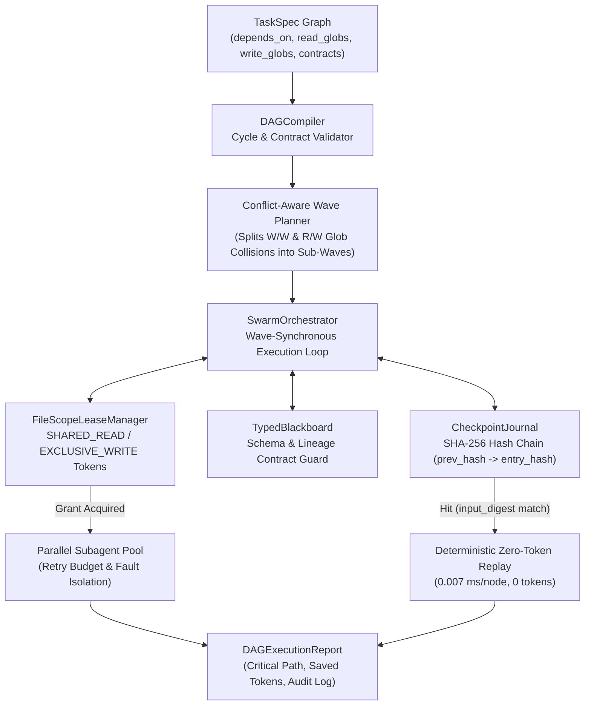

# SwarmWeaver

[](https://github.com/codesphere-u/swarmweaver/actions/workflows/ci.yml)
[](https://www.python.org/downloads/)
[](LICENSE)
[](#mcp-server-integration)
[](pyproject.toml)

**Deterministic Multi-Agent DAG Orchestrator, File-Scope Lease Conflict Guard & Crash-Safe Checkpoint Resume Engine (with MCP Server).**

---

## Why `swarmweaver`?

Engineering teams running parallel multi-agent swarms (subagents editing code, running analyses, and synthesizing reports concurrently) repeatedly hit three critical production failures:

1. **File Clobbering & Race Conditions:** Two parallel subagents edit overlapping files, directory globs, or AST symbols simultaneously, silently overwriting each other's patches.
2. **Crash Amnesia on Long-Running DAGs:** A 15-node multi-agent workflow fails at node 12 due to a transient rate limit or timeout, forcing the orchestrator to re-run nodes 1–11 from scratch and burn duplicate tokens.
3. **Unvalidated Handoffs & Cyclic Deadlocks:** Agents pass unstructured prose between steps ("telephone game" drift) or declare cyclic task dependencies that deadlock execution.

**SwarmWeaver** solves all three problems in a zero-dependency Python 3.11+ engine and JSON-RPC 2.0 Model Context Protocol (MCP) server:

- **Conflict-Aware Parallel Wave Compiler (`DAGCompiler`):** Groups tasks by topological level, detects cycles with exact cycle path reporting (`A -> B -> C -> A`), and automatically splits tasks with write-write or read-write file-glob overlaps (`fnmatch`, directory prefix, and `file.py::symbol` scope) into sequential sub-waves so parallel subagents **never** clobber the same file.
- **Pessimistic/Optimistic File-Scope Lease Guard (`FileScopeLeaseManager`):** Enforces `SHARED_READ` and `EXCLUSIVE_WRITE` locks at runtime with deadlock-free canonical acquisition order, TTL expiration, cryptographic SHA-256 lease tokens, and an immutable `LeaseConflict` audit log.
- **Hash-Chained Crash-Safe Checkpoint Journal (`CheckpointJournal`):** Content-addressable JSONL journal (`prev_hash -> entry_hash`) that replays completed nodes whose `input_digest` matches in **`0.007 ms/node`** with **`0` tokens spent** when resuming a crashed workflow (`engine.execute(resume=True)`).
- **Schema-Enforced Shared State (`TypedBlackboard`):** Validates required `input_contract` keys and inline/custom type schemas before a downstream agent starts, and verifies `output_contract` artifacts before a task can mark itself `COMPLETED`.

---

## System Architecture



---

## Verified Benchmark Results (`v1.0.0`)

Reproducible via `swarmweaver benchmark` (65 unit & concurrency tests, zero external runtime dependencies):

| Benchmark Dimension | Workload | Verified Result | Key Metric |
| :--- | :--- | :--- | :--- |
| **1. DAG Compilation & Wave Scheduling** | 200-task, 10-layer multi-agent DAG (160 file conflicts) | **P50: `23.38 ms`** / **P95: `25.14 ms`** | `30` safe waves, **`5.93x`** speedup |
| **2. Parallel File-Scope Conflict Guard** | 50 concurrent conflicting file/glob edit tasks | **`0` race conditions** | **`100.0%`** collision prevention |
| **3. Crash-Recovery Token Savings** | 20 workflows (10 steps each), crash injected at 70% | **`140,000` / `200,000` tokens saved** | **`70.0%`** token savings, **`0.0074 ms/node`** replay |
| **4. Cycle & Contract Violation Guard** | 15 malformed DAGs (cycles, missing deps, bad contracts) | **`15 / 15` detected** | **`100.0%`** detection recall |

---

## Quickstart

### Installation

```bash
git clone https://github.com/codesphere-u/swarmweaver.git
cd swarmweaver
pip install -e ".[dev]"
```

### CLI Usage

```bash
# 1. Compile the 10-agent full-stack refactoring swarm into conflict-free parallel waves
swarmweaver plan

# 2. Run the 10-agent swarm demo with an injected crash at node 8 + instant zero-token resume
swarmweaver demo

# 3. Run the reproducible 4-part benchmark suite (human-readable or JSON)
swarmweaver benchmark
swarmweaver benchmark --json

# 4. Verify the SHA-256 hash chain of a persisted checkpoint journal
swarmweaver verify-journal ./path/to/checkpoint.jsonl
```

### Python SDK Usage

```python
from swarmweaver import SwarmOrchestrator, TaskSpec

tasks = [
    TaskSpec(
        task_id="scan_ast",
        title="Audit auth module AST",
        agent_role="auditor",
        read_globs=["src/auth/**/*.py"],
        output_contract=["ast_report:dict"],
        estimated_tokens=800,
    ),
    TaskSpec(
        task_id="patch_jwt",
        title="Harden JWT token verifier",
        agent_role="auth-coder",
        depends_on=["scan_ast"],
        write_globs=["src/auth/jwt.py"],
        input_contract=["ast_report:dict"],
        output_contract=["jwt_patch:dict"],
        estimated_tokens=1200,
    ),
    TaskSpec(
        task_id="patch_rbac",
        title="Update RBAC claims in jwt.py",
        agent_role="policy-coder",
        depends_on=["scan_ast"],
        # Overlaps with patch_jwt on src/auth/jwt.py -> automatically split into a sequential sub-wave!
        write_globs=["src/auth/jwt.py", "src/auth/rbac.py"],
        input_contract=["ast_report:dict"],
        output_contract=["rbac_patch:dict"],
        estimated_tokens=950,
    ),
]

orchestrator = SwarmOrchestrator(
    tasks,
    workflow_id="auth-hardening-v1",
    journal_path=".swarmweaver/auth_journal.jsonl",
    validate_contracts_at_compile=True,
)

# If a prior run crashed midway, resume=True replays completed nodes in <0.01ms with 0 tokens!
report = orchestrator.execute(resume=True)
print(f"Status: {report.status} | Waves: {report.wave_plan.waves}")
print(f"Tokens Spent: {report.tokens_spent} | Tokens Saved: {report.tokens_saved_by_replay}")
```

---

## MCP Server Integration

`swarmweaver` includes a built-in JSON-RPC 2.0 Stdio MCP server (`swarmweaver mcp`) exposing 4 tools to Claude Code, Cursor, Antigravity, and custom MCP clients:

| MCP Tool Name | Description |
| :--- | :--- |
| `swarmweaver_plan_waves` | Compiles a list of tasks into conflict-free parallel execution waves and critical-path metrics. |
| `swarmweaver_check_file_conflicts` | Tests whether a proposed batch of parallel subagent tasks has write/write or read/write file-glob collisions. |
| `swarmweaver_inspect_checkpoint` | Verifies a checkpoint journal's SHA-256 hash chain (`prev_hash -> entry_hash`) and reports resumable vs. pending tasks. |
| `swarmweaver_run_benchmark` | Runs the deterministic SwarmWeaver benchmark suite and returns structured telemetry. |

### Claude Code / Cursor / Antigravity `mcpServers` Config

```json
{
  "mcpServers": {
    "swarmweaver": {
      "command": "swarmweaver",
      "args": ["mcp"]
    }
  }
}
```

---

## Part of the Codesphere Agentic Infrastructure Ecosystem

SwarmWeaver is built by **Akandwanaho Ivan Alvin** ([`@codesphere-u`](https://github.com/codesphere-u)), Founder & Managing Director of **Codesphere Innovations (U) Limited** (Kampala, Uganda), as part of a modular open-source stack for production-grade AI engineering:

- [**`swarmweaver`**](https://github.com/codesphere-u/swarmweaver) — Deterministic Multi-Agent DAG Orchestrator, File-Scope Lease Conflict Guard & Crash-Safe Checkpoint Resume Engine.
- [**`patchpilot`**](https://github.com/codesphere-u/patchpilot) — Autonomous Code Repair Engine: Stack-Trace & AST Fault Localizer, Anti-Reward-Hacking Patch Verifier & Transactional Sandbox.
- [**`synapse-router`**](https://github.com/codesphere-u/synapse-router) — Complexity-Aware Multi-Model LLM Router, LinUCB Contextual Bandit, Semantic Cache & Budget Guard.
- [**`agentflight`**](https://github.com/codesphere-u/agentflight) — Deterministic Flight Recorder, Cryptographic Action Ledger & Chaos Replay Engine for Autonomous AI Agents.
- [**`cortex-mcp`**](https://github.com/codesphere-u/cortex-mcp) — AST-Native Codebase Graph, Hybrid RRF Semantic Search & Token-Budgeted Context Engine.
- [**`agentshield`**](https://github.com/codesphere-u/agentshield) — Zero-Trust Runtime Security Firewall, Prompt-Injection Detector & Tool-Call Policy Enforcer for AI Agents.
- [**`ARGUS-AI`**](https://github.com/codesphere-u/ARGUS-AI) — Multi-Modal Enterprise Intelligence & Observability Platform.

---

## License

Released under the [MIT License](LICENSE). Copyright (c) 2026 Akandwanaho Ivan Alvin (Codesphere Innovations (U) Limited).
